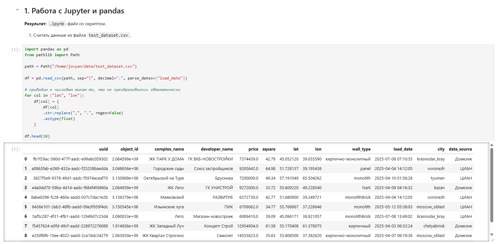
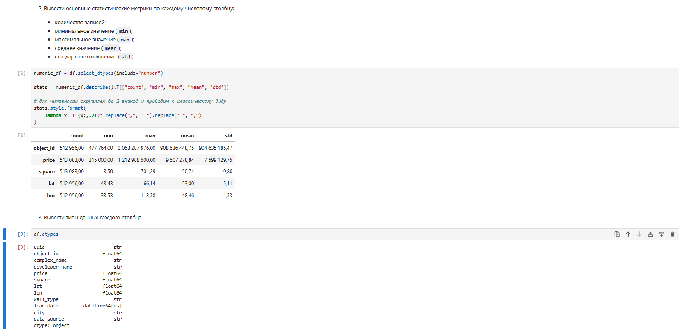

# Запуск

1. Скачайте репозиторий

2. Создайте переменную окружения

    ```bash
    cp .env.example .env
    ```

3. Поместите `test_dataset.csv` в директорию `data/`

4. Запустите контейнеры:

   ```bash
   docker compose up -d
   ```

## Демонстрация

### 1. Загрузка и просмотр данных



### 2. Обработка и анализ данных




## Запуск
```bash
cp .env.example .env
docker compose up -d
```

# Демонстрация

## 1. Работа с Jupyter и pandas, результат ipynb-файл со скриптом

### 1. Загрузка и просмотр данных


### 2. Вывод

